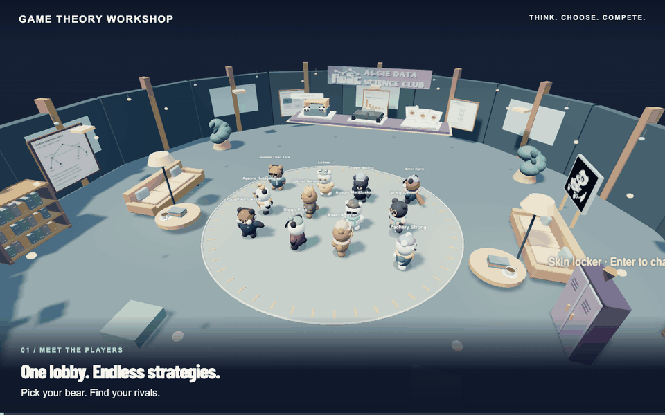
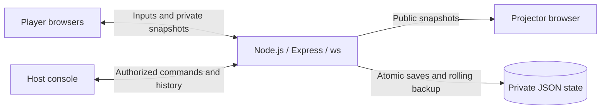

# Game Theory Workshop



A browser-based 3D multiplayer platform that turns game-theory concepts into playable experiments. Players explore a shared panda-themed lobby, then compete in **Crowd Rush**, **Battlefield (Colonel Blotto)**, and **Kuhn Poker**. A host console controls the session while a separate projector view presents the action.

**Used by 30 concurrent players at a live university club workshop on October 13, 2026**, deployed on Railway. The application currently admits up to 40 participants; local 40-client protocol rehearsals are separate from the live attendance figure.

Built with **JavaScript · Three.js/WebGL · Node.js · Express · WebSockets · Vite · Railway**. The interface uses HTML/CSS; Canvas generates many textures, and Web Audio supplies synthesized effects alongside recorded clips.

## The games

| Activity    | Experiment                                     | Implementation                                                                                                                                                            |
| ----------- | ---------------------------------------------- | ------------------------------------------------------------------------------------------------------------------------------------------------------------------------- |
| Crowd Rush  | Congestion and shared rewards                  | Five arenas, timed vault selection, platforming hazards, and reward pools split among players inside each vault at settlement.                                            |
| Battlefield | Resource allocation and strategic coordination | Team formation, shared resources with personal wallets, three contested fronts, private orders, and five rounds introducing supply bonuses, counters, and fortifications. |
| Kuhn Poker  | Bluffing under imperfect information           | Five two-hand rounds, rotating opponents, private J/Q/K cards, legal betting actions, decision deadlines, and a bot to fill an odd seat.                                  |

The lobby includes optional practice areas and character customization. Host tools provide readiness checks, pause/resume, player moderation, chat monitoring, and projector camera/audio controls.

## Architecture



- **Server authority:** a 20 Hz simulation/broadcast loop validates movement, purchases, betting, deadlines, and scoring. Clients render with local movement prediction and remote interpolation.
- **Information boundaries:** each player receives their own cards and team-only information. The projector receives public state; detailed history and team-chat monitoring require host authorization.
- **Network handling:** incremental roster/motion snapshots, bounded compression, input/action budgets, heartbeats, and slow-client backpressure controls keep traffic bounded.
- **Persistence:** the server saves identities, scores, moderation settings, and scored-play history to JSON. Writes are coalesced and atomically replaced, with a rolling backup. Browser storage retains reconnect identity and preferences.
- **Rendering:** procedural Three.js geometry and Canvas textures create most scenery. Static meshes are batched by material; graphics and reduced-motion options accommodate different devices. PNG branding and MP3 clips are separate assets.

```text
src/       Browser entry point, scenes, game interfaces, audio, and host tools
server/    HTTP/WebSocket entry point, authoritative games, access, and storage
shared/    Rules, movement, scoring, snapshot protocol, and camera helpers
public/    Static artwork and audio
tests/    Unit tests, isolated process integration, and load rehearsals
```

Start reading with `server/index.js` (transport), `server/game.js` (session lifecycle), `src/main.js` (client coordination), and `src/scene.js` (rendering). `server/battlefield.js` and `server/poker.js` own the other game lifecycles. Reusable rules live in `shared/`, including `tournament.js` and `snapshot-stream.js`.

### Scoring and recovery

Crowd Rush accumulates vault earnings, Battlefield accumulates team territory, and Poker accumulates net chips. Each activity's cumulative raw score is converted to rank points with a 100-point ceiling; the tournament total is the sum of the three activities. Ties share rank points. Every completed scored replay contributes to raw totals and history; practice and demo rounds do not.

Refresh/reconnect uses the existing browser identity. Clearing site storage or changing domains creates a different identity. **A server restart retains saved scores but returns the active activity to the lobby**; it does not resume an unfinished hand or battle.

## Run locally

Requires **Node.js 22.12–22.x** and npm.

```sh
npm ci
HOST_KEY=local-dev-only npm run dev
```

| View      | URL                                   |
| --------- | ------------------------------------- |
| Player    | http://localhost:3000/                |
| Host      | http://localhost:3000/?view=host      |
| Projector | http://localhost:3000/?view=projector |

Enter `local-dev-only` in the host sign-in form. Development without `EVENT_CODE` skips attendee/projector access gates; keep this mode local. Different browser profiles can simulate separate players. Two tabs using the same stored identity share a player.

Use the host's activity selector to load games. Battlefield requires team matching before rounds begin. Solo demos are available for Battlefield and Poker. Click the projector once to unlock browser audio.

## Deploy

Run **one long-lived Node process** serving both the built client and WebSockets. The room is held in process memory; multiple replicas do not share it. No external database is required.

For Railway:

1. Connect the GitHub repository using Railpack. Set **Build Command** to `npm run build` and **Start Command** to `node server/index.js`. Railpack installs dependencies separately; do not run a second `npm ci` in the build command.
2. Attach a persistent volume at `/data`, keep one instance, and configure the variables below.
3. Set `/health` as the healthcheck. Generate an HTTPS domain whose target port matches `PORT`; the app listens on `0.0.0.0`. Railway supplies `PORT` and terminates HTTPS/WSS.
4. Disable service sleeping for the event. Rehearse on actual devices and Wi-Fi; disable automatic deployments during play. Restart only between rounds.

| Variable        | Production value                                     |
| --------------- | ---------------------------------------------------- |
| `NODE_ENV`      | `production`                                         |
| `STATE_FILE`    | `/data/workshop.json`                                |
| `EVENT_CODE`    | Attendee code, at least 8 characters                 |
| `HOST_KEY`      | Independent host secret, at least 16 characters      |
| `SPECTATOR_KEY` | Independent projector secret, at least 16 characters |

Generate administrative secrets separately with `openssl rand -hex 24`; all three codes must differ. Configure them in Railway Variables. Share only the attendee code and enter administrative secrets in sign-in forms, never URLs. For a fresh event, choose a new state filename rather than deleting an existing score file.

For local production testing, copy `.env.example` to `.env`, replace its placeholders, and run:

```sh
npm run build
node --env-file=.env server/index.js
```

`.env` is not automatically loaded by npm commands. Never commit credentials or saved state. `/health` reports storage failure as unavailable; investigate the saved file rather than erasing it.

## Development checks

```sh
npm run check          # Formatting, unit tests, build, and process integration
npm run format         # Apply shared formatting conventions
npm test               # Unit tests only
npm run test:integration
```

GitHub Actions runs the same check on pushes and pull requests with Node 22. Tests cover game rules, settlement, movement, reconnects, private-state isolation, moderation, and durable recovery. Integration starts an isolated server with a temporary state file and OS-assigned port; no real service credentials are needed.

For manual load rehearsals, start a **separate development server** with a fresh state file:

```sh
NODE_ENV=development PORT=3016 HOST_KEY=load-test STATE_FILE=/tmp/game-theory-load.json npm run dev
# In another terminal, choose one rehearsal:
TEST_URL=ws://127.0.0.1:3016 HOST_KEY=load-test npm run load:battlefield
```

Other scripts: `load:crowd`, `load:poker`, and `load:traffic`. Start a fresh room for each. These scripts modify state and must never target a live event. Protocol load tests do not certify rendering performance on forty laptops or campus Wi-Fi.

## Scope and assets

This is a single-room workshop application, with shared access codes rather than individual accounts. The current admission cap is 40; larger rosters require coordinated game-limit changes and validation. Persistent files contain private reconnect credentials and should stay outside the repository. Rate limits and filtering support moderation but are not a guarantee against abuse.

Developed by Anshul Khandekar for the TAMU Aggie Data Science Club. Club, sponsor, and event artwork are supplied branding assets; their presence does not imply endorsement or transfer of trademark rights. No blanket license for third-party artwork or audio is granted by this repository.
